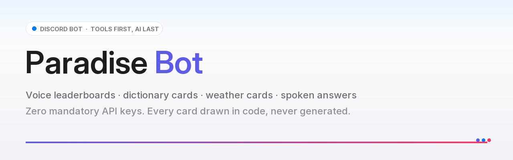
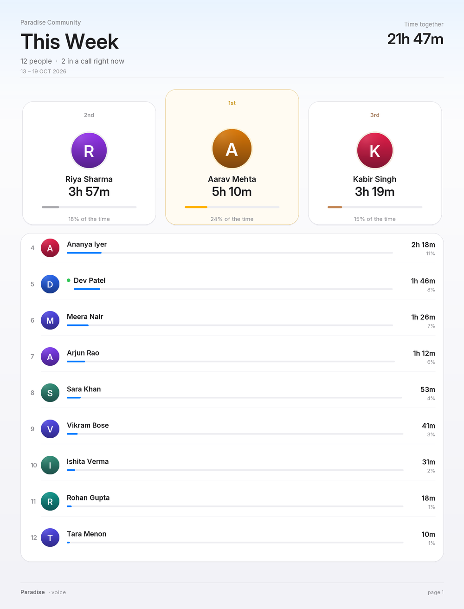

<div align="center">



**A Discord bot for a real friend group.** Search, weather, conversions, a
dictionary, mini-games, voice-activity leaderboards — and an AI layer that is
only ever the *last* resort.

[](https://github.com/STUP1DLADKAA/ParadiseBOT/actions/workflows/ci.yml)
[](https://www.python.org/)
[](https://github.com/Rapptz/discord.py)
[](LICENSE)
[](#testing)
[](#built-with-ai)

[Quick start](#quick-start) · [Features](#what-it-does) · [Screenshots](#screenshots) ·
[Configuration](.env.example) · [Honest AI disclosure](#built-with-ai) · [Contributing](CONTRIBUTING.md)

</div>

---

## Honest AI disclosure

> **Parts of this project were generated with AI assistance, and the bot itself
> contains AI features.** Both facts are stated plainly here rather than buried.

**1. How this codebase was built.** Paradise was written by its owner working
*with* AI assistants — architecture, module code, tests and documentation have
all had AI involvement. Every change was reviewed, run and tested before it
landed (`845` offline tests, a static review agent and CI gate the merge), but
you should treat the code the way you would treat any contributor's: read it
before you trust it. Sections that were AI-assisted are not individually marked
because, after this much iteration, the distinction is no longer meaningful.

**2. What in the bot uses AI.** The bot is *tool-first*: a deterministic router
handles calculations, conversions, weather, time, translations, dictionary
lookups and image search **without any model**. AI is used only where a tool
cannot answer:

| Where | What it is | Key required |
| --- | --- | --- |
| `@Paradise <complex question>` | Gemini reasoning (or an OpenAI-compatible fallback) | optional |
| `Hey Paradise …` in voice chat | fastest-first Gemini cascade, then spoken aloud | optional |
| `Hey Paradise …` **spoken** in the channel | **on-device** Whisper (faster-whisper, this CPU, no upload) → Gemini answer → your voice | optional |
| `/summarize` | Gemini summary of pasted text | optional |
| Passive personality | rare canned reactions/replies — **no model**, just local templates | never |
| Music | yt-dlp search, FFmpeg decode, numpy mixing — **no model**, no cloud music API | never |

**3. What is *not* AI.** Every image the bot produces — leaderboard cards,
dictionary cards, weather cards, recipe cards — is drawn programmatically with
Pillow. There is no image generation anywhere in this repository, and image
search returns *real* photos from Wikipedia/Wikimedia/Openverse instead of
made-up ones.

**4. What leaves the machine.** One thing: a question, sent to Gemini when it
actually needs a model. Recognition of the **spoken** wake word runs on this
machine — faster-whisper on this CPU, inside the bot, with no key and no
upload — so your voice never leaves it. Music, cards, voice tracking, the
dictionary and every deterministic tool run locally too. Nothing about your
voice is stored: the buffers are in memory, bounded, and dropped after
transcription. Cloud recognition exists as a fallback for hosts that cannot run
Whisper, and is never chosen while the local engine is installed.
[Full privacy notes](docs/voice-wake.md#privacy-honestly).

With **no API key at all** the bot is fully functional: only free-form
conversation, `/summarize`, the spoken answers and the spoken wake word are
unavailable.

---

## What it does

| | |
| --- | --- |
| **Mention-first interface** | `@Paradise 100 USD to INR`, `@Paradise weather in Delhi`, `@Paradise define ephemeral` — no slash commands to memorise. A deterministic router picks the right native tool; two requests in one sentence run concurrently. |
| **Voice leaderboards** | Supabase-backed tracking with crash-safe checkpoints, IST calendar windows and a daily DM that reads like a note from a person. The card is a rendered page — a podium, then one grouped list, in white on light grey with a single accent per period. |
| **Cards, drawn in code** | Dictionary, weather, recipe, mini-game and leaderboard visuals are Pillow-rendered at 2× supersampling — deterministic, cacheable, never generated. The leaderboard's contrast ratios are asserted in the test suite, not eyeballed. |
| **Your own voice** | Optional ElevenLabs voice for every spoken word, with an OpenAI-compatible and a free web fallback. Hindi, English and Hinglish. |
| **"Hey Paradise"** | Type the phrase in a voice channel's text chat, **or just say it out loud**: answered in the chat *and* spoken in the channel, in the same voice. Spoken requests are transcribed **on the bot's own CPU** (faster-whisper, no key, nothing uploaded) once the sentence has ended. [Details](docs/voice-wake.md). |
| **Music, with talk-over** | "Hey Paradise play billie jean" — in English, Hinglish or Devanagari. The song plays, and every answer **ducks it to 15 %** for the length of the sentence, then lifts it back. Queue, loop, shuffle, pause, skip, volume, and a `/cmd` button panel. [How it works](docs/music.md). |
| **Silent presence** | Follows the crowd into the busiest voice channel and says nothing when it arrives. |
| **Mini-games** | A recoverable SQLite scheduler, four modular games, aggregate-only leaderboard. |
| **Self-updating** | Pulls the latest revision from GitHub on start-up and while online — validated, backed up, crash-loop guarded, and it never touches `.env` or `data/`. |
| **No mandatory keys** | Search, dictionary, conversions, calculator, weather, time and translation work with zero configuration. |

### Tool-first, AI-last

```
your message
   ↓
request normalizer (typos, slang, Hinglish, emoji, filler)
   ↓
intent router (deterministic, microseconds)
   ↓
can a native tool answer?   calculator · define · convert · image · weather · time · translate
   ├── YES → specialised tool, zero AI
   └── NO
        can web search answer?      → answer + key points + sources (never bare links)
        ├── YES → native sourced answer (AI may explain the sources, never invent them)
        └── NO
             still ambiguous?       → one tiny Gemini JSON label, then re-route
             needs real reasoning?  → Gemini (or the OpenAI-compatible fallback)
             └── everything else    → asks what you meant
```

`"25% of 800"`, `"100 USD to INR"`, `"weather in Delhi"` and `"a picture of a
red panda"` never touch a model. When AI *is* used over web results it only
explains retrieved evidence — it never supplies facts of its own, and a failed
lookup is reported honestly instead of being guessed.

---

## Screenshots

<div align="center">

**`/vc leaderboard` — rendered live, ten rows per page, one quiet accent per period**



<sub>Generated by the bot's own renderer (`python tools/make_assets.py`) with fictional members.</sub>

</div>

---

## Music: it plays, and it talks over the song

```text
you │ hey paradise, play billie jean
bot │ 🎵 playing **Billie Jean** (4:53)
you │ hey paradise, who sang this?
    │ ┌ the song fades 1.0 → 0.15 in 240 ms
bot │ 🗣 "Michael Jackson wrote and performed it in 1982."
    │ └ the song fades back to 1.0, never losing its place
```

Every other music bot stops the song to speak, or talks *over* it at full
volume. Paradise **mixes**: the song and the ElevenLabs voice are two PCM
streams added together 50 times a second, with the music gain ramped down for
exactly as long as the sentence lasts. The maths is 20 lines of numpy and it is
tested against a real FFmpeg stream.

| Ask | English | Hinglish |
| --- | --- | --- |
| play | `Hey Paradise play billie jean` | `billie jean baja do` |
| skip | `Hey Paradise skip` | `agla` / `अगला गाना लगाओ` |
| pause | `Hey Paradise pause` | `pause karo` / `रोक दो` |
| stop | `Hey Paradise stop` | `band karo` / `ruko` |
| volume | `Hey Paradise volume 30` | `awaaz kam karo` |
| what's this | `Hey Paradise what's playing` | `kaun sa gaana chal raha hai` |

Also `/music …`, `!p …`, and `/cmd` for a button panel with the whole
transport. Full setup, configuration and troubleshooting: **[docs/music.md](docs/music.md)**.

> **Why not Lavalink?** Because Lavalink v4 owns the Discord voice connection —
> it sends Opus to Discord itself, so there is no local audio to mix the answer
> into and no local volume to duck. Lavalink and "speak over the song at 15 %"
> are mutually exclusive; the feature you asked for won. The reasoning is
> written up in [docs/music.md](docs/music.md#why-not-lavalink-v4).

---

## Quick start

**Requirements:** Python 3.11+, a Discord bot token, and ~150 MB of disk for
dependencies (+250 MB if you also install on-device speech recognition).
Linux, macOS and Windows all work.

```bash
git clone https://github.com/STUP1DLADKAA/ParadiseBOT.git
cd ParadiseBOT

python -m pip install -r requirements.txt
cp .env.example .env          # then fill in DISCORD_TOKEN
python bot.py

# optional: hear the wake word out loud, transcribed on this machine
python -m pip install -r requirements-local-stt.txt
```

1. Create an application in the [Discord Developer Portal](https://discord.com/developers/applications).
2. On the **Bot** page enable **Message Content Intent** and **Server Members
   Intent** (used for mentions, AFK handling, personality and voice tracking).
3. Invite it with the `bot` and `applications.commands` scopes. Recommended
   permissions: View Channels, Send Messages, Embed Links, Attach Files, Add
   Reactions, Read Message History, Connect, Speak.
4. Set `DISCORD_GUILD_ID` to your server's ID so slash commands appear
   **instantly** (without it they register globally, which Discord can take up
   to an hour to propagate).

That is the whole setup. Everything else — AI, voice, Supabase — is optional
and degrades gracefully when absent.

### Docker

```bash
docker build -t paradisebot .
docker run -d --name paradise --env-file .env -v "$PWD/data:/app/data" paradisebot
```

The container runs as a non-root user, keeps `data/` on a volume, and restarts
unless stopped.

### Minimum vs. full configuration

| Want | Set | Effect if missing |
| --- | --- | --- |
| The bot works at all | `DISCORD_TOKEN` | refuses to start with a clear message |
| Instant slash commands | `DISCORD_GUILD_ID` | commands register globally (slow propagation) |
| Voice leaderboards | `SUPABASE_URL`, `SUPABASE_SECRET_KEY` + [4 SQL migrations](supabase/README.md) | `/vc` explains what to set up; nothing else breaks |
| Music | nothing beyond `pip install -r requirements.txt` and FFmpeg | `/music play` says what is missing |
| Spoken wake word (on-device) | `pip install -r requirements-local-stt.txt` — no key at all | typed "Hey Paradise" still works; `/voicewake status` explains how to install it |
| Spoken wake word (cloud fallback) | `VOICE_WAKE_STT=elevenlabs` + `ELEVENLABS_API_KEY`, or `gemini` + `GEMINI_API_KEY` | on-device recognition is used instead — no audio leaves the bot |
| AI answers | `GEMINI_API_KEY` (or `AI_BASE_URL`/`AI_MODEL`) | tool/mention replies still work, no free-form reasoning |
| Spoken answers in your voice | `ELEVENLABS_API_KEY`, `ELEVENLABS_VOICE_ID` | free fallback voice, or text only |
| Weather alerts & midnight board | `VOICE_ALERT_CHANNEL_ID` | those two posts are skipped |

Every option, with defaults and clamps, lives in [`.env.example`](.env.example).

---

## File structure

```
ParadiseBOT/
├── bot.py                     entry point: intents, startup flow, message dispatch
├── config.py                  every environment setting, parsed and clamped in one place
├── commands/                  slash commands and cogs
│   ├── assistant.py           mention router: "@Paradise <anything>" → tools first, AI last
│   ├── vc.py                  /vc leaderboard · /vc stats · /vc dmreports
│   ├── wake.py                "Hey Paradise …" — typed, spoken aloud, answered in voice
│   ├── voice_presence.py      silent crowd-following into voice channels
│   ├── clip.py                rolling voice-clip capture and export
│   ├── dictionary.py          chat triggers, cards, playback buttons
│   ├── minigames.py           game scheduler, admin controls, leaderboard
│   ├── edit.py                operator-only voice-time corrections
│   ├── music.py               /music · /cmd panel · !p-style commands · voice bridge
│   ├── ai.py · recipe.py · fun.py · system.py · utility.py
├── functions/                 the engines, framework-free and unit-testable
│   ├── router.py · routes.py · normalize.py · keywords.py · intent.py
│   ├── calculator.py          AST-whitelisted calculator (percent idioms, word operators)
│   ├── search/                DuckDuckGo + Wikipedia + a sourced answer pipeline
│   ├── weather/               Open-Meteo provider, fuzzy geocoding, 16:9 card
│   ├── conversion/            units, currency, natural-language parser
│   ├── time/                  IANA timezone resolver and city maps
│   ├── dictionary/            engine, card renderer, human/neural pronunciation
│   ├── images/                real web image search, URL safety, embed builder
│   ├── voice/                 tracking, Supabase persistence, windows, card renderer
│   ├── voice_clip/            Opus decoding, rolling buffer, mixer, AAC export
│   ├── minigames/             recoverable scheduler + four games
│   ├── recipes/               recipe engine and bundled recipe book
│   ├── music/                 yt-dlp search, FFmpeg PCM, ducking mixer, queue, intents
│   ├── voice_wake/            endpointing, wake-phrase matching, on-device whisper
│   ├── tts.py                 ElevenLabs → OpenAI-compatible → free voice
│   ├── gemini.py · ai.py      model cascade, provider chain, activation rules
│   ├── perf.py                shared HTTP pools, render pool, start-up prewarm
│   ├── autoupdate.py          validated, crash-loop-guarded self-update
│   ├── startup.py             the single owner of command-tree writes
│   └── cache.py · helpers.py · personality.py · presence.py · translate.py
├── assets/                    bundled fonts (OFL), README images
├── benchmarks/                offline voice-pipeline harness + recorded results
├── docs/                      setup guides and engineering write-ups
│   └── engineering/           incident report and optimisation report
├── supabase/                  SQL migrations, local validator, schema docs
├── tests/                     845 offline tests — no network, no credentials
├── tools/                     review agent, asset generator
│   └── repro/                 incident reproducers and the invariant fuzzer
├── .env.example · requirements.txt · pyproject.toml · LICENSE
└── .github/workflows/ci.yml   tests + static review on every pull request
```

**Rules the layout follows**

* `commands/` only ever talks to Discord; all logic lives in `functions/`.
* Every `functions/` module is importable and testable without a gateway.
* One secret source (`config.py` ← environment). Nothing else reads `.env`.
* `tools/repro/` is diagnostics, never imported by the bot.

---

## Testing

```bash
python -m pip install -r requirements-dev.txt
python -m pytest -q                       # 845 passed
python tools/review_agent.py --self-test  # static-review rules
python benchmarks/voice_pipeline.py --label ci --latency 0 --users 4 --toggles 1
```

Everything runs **offline**: HTTP is replaced with fakes, Supabase with an
in-memory double, and Discord with stubs. No token, no key, no network needed.

---

## Configuration highlights

A trimmed view — see [`.env.example`](.env.example) for all ~120 settings.

| Group | Variables | Notes |
| --- | --- | --- |
| Discord | `DISCORD_TOKEN`, `DISCORD_GUILD_ID` | token required; guild ID makes commands instant |
| Operator access | `EDIT_ALLOWED_USER_IDS`, `CLIP_ALLOWED_USER_IDS`, `VOICE_DEAF_EXEMPT_USER_IDS` | comma-separated Discord user IDs |
| Voice data | `SUPABASE_URL`, `SUPABASE_SECRET_KEY`, `VOICE_*` | service-role key only, server-side |
| AI | `GEMINI_API_KEY`, `GEMINI_MODEL`, `GEMINI_MODEL_CHAIN`, `AI_BASE_URL`, `AI_MODEL` | all optional |
| Your voice | `ELEVENLABS_API_KEY`, `ELEVENLABS_VOICE_ID`, `ELEVENLABS_MODEL` | default `eleven_flash_v2_5` |
| Wake word | `WAKE_WORD_*` | typed + spoken answers in voice chat |
| Presence | `VOICE_PRESENCE_ENABLED`, `VOICE_ARRIVAL_ANNOUNCE` | silent joins by default |
| Clips | `VOICE_CLIP_*` | 192 kbps AAC, mastering chain, 180 s window |
| Self-update | `AUTO_UPDATE_*` | validated pull from GitHub; `AUTO_UPDATE_APPLY=false` to only be notified |
| Performance | `PREWARM_ON_START` | warm fonts and card backdrops at boot |

**Performance defaults.** Thread pools and HTTP connection pools are sized to
the machine (`8–32` workers, up to `256` connections, one pooled session per
service). Cards render at 2× supersampling, and identical renders inside a
45-second window are served from cache. See [docs/performance.md](docs/performance.md).

---

## Security & privacy

* Secrets come from the environment only; `.env` is git-ignored and
  `.env.example` is the only template in the repository.
* API keys travel in headers, are masked in logs, and never appear in a
  message, an error or a stack trace. `tools/review_agent.py` fails CI on a
  committed secret.
* Voice audio lives in a bounded in-memory ring buffer (default 180 s) and is
  only exported on request, by an allow-listed operator, to a DM. It is never
  uploaded anywhere else.
* A deafened Discord client receives no audio — the bot therefore joins
  undeafened on purpose and explains the limit instead of pretending.
* Self-update refuses archives that fail validation and never touches `.env`,
  `.git`, `data/`, databases, logs or caches.

---

## Built with AI

To restate the disclosure at the top of this file, because it matters:

* **The bot includes AI features** — Gemini for open-ended reasoning, optional
  ElevenLabs for speech. All are opt-in, key-gated and clearly separated from
  the deterministic tool layer.
* **This repository was developed with AI assistance.** Treat the source as
  you would any contributor's work. The tests, the review agent and CI exist
  precisely so that no unverified change lands.
* **No generated media.** Every image and card is drawn with Pillow; image
  search returns real, attributed photos. If you see a picture in this
  repository, it was rendered from data — not imagined.

---

## Contributing

Issues and pull requests are welcome — see [CONTRIBUTING.md](CONTRIBUTING.md)
for the conventions, the test expectations and how to run the review agent
locally. Be kind: [CODE_OF_CONDUCT.md](CODE_OF_CONDUCT.md).

## License

[MIT](LICENSE). Bundled Inter fonts are under the SIL Open Font License 1.1
(see [assets/fonts/Inter-OFL.txt](assets/fonts/Inter-OFL.txt)).

<sub>Paradise is a hobby project for one friend group that grew into a
toolbox. It deliberately has no dashboard, no moderation suite, no music
player and no monetisation.</sub>
